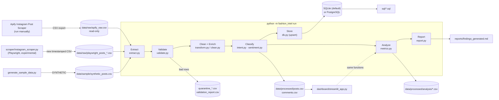

# Architecture

## Stages

| Stage | Module | What it does | Fails how |
|---|---|---|---|
| Extract | `extract.py` | Detects the input format (Apify or generic posts CSV). Builds tidy `posts` and `comments` tables. Records provenance: file name, SHA-256 hash, row number, extraction time. Attributes each post to the **scraped profile**, not the post owner. | Unknown format raises an error. Scraper error rows go into the validation report. |
| Validate | `validate.py` | Checks required columns (hard error), missing IDs (row quarantined), duplicates, unknown platforms, brands missing from the registry, hidden likes, collab posts, missing timestamps. | Never drops rows silently. Every issue is counted in `validation_report.csv`. |
| Clean | `clean.py`, `transform.py` | Parses `1.2K`/`2.3M`/`1,234` counts, treats `-1` as hidden, normalises URLs, handles and platform names, unifies text, parses timestamps to UTC (malformed becomes NaT), deduplicates on stable IDs. | Unknown values become NULL, never 0. |
| Enrich | `transform.py` | Adds Lagos-local (WAT) date, hour and weekday, the audit-window flag, brand registry fields, `interactions`, and caption seller signals. Pseudonymises commenters. | Derived values are NULL when any input is unknown. |
| Classify | `intent.py`, `sentiment.py` | Assigns audience-comment purchase intent (5 labels) and, separately, sentiment. | Never raises. Any input gets a label. |
| Store | `db.py` | Idempotent upsert into 4 tables inside one transaction. Records a `pipeline_runs` row. | Rolls back fully on any error. Never drops or alters tables. |
| Analyze | `metrics.py` | Coverage, engagement, intent, posting time, sensitivity. Every rate states its denominator. | Zero denominators return NaN. |
| Report | `report.py` | Writes `reports/findings_generated.md` (numbers only). | – |

## Why these choices

- **SQLite by default, PostgreSQL supported.** Anyone who clones the repo can run it with no database server. Set `DATABASE_URL` in `.env` to use PostgreSQL. The same SQL files run on both, and tests check that SQL and Python agree.
- **New table names** (`social_posts`, not `posts`). Pointing the pipeline at the original `fashiondb` cannot collide with or alter the legacy v1 tables.
- **Upsert on natural keys** (`instagram:<shortcode>`, Instagram comment IDs). Re-running the pipeline gives the same database state.
- **One metrics module** used by the report, the dashboard, and the tests. The numbers cannot drift apart.
- **Rules before models.** See `nlp_model_decision.md`.
